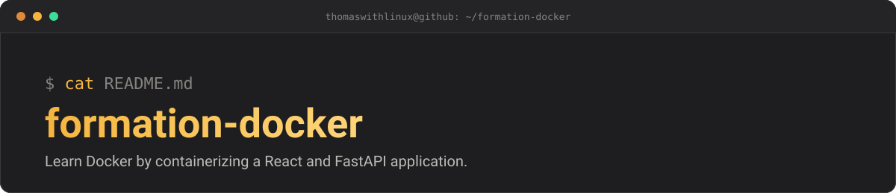

<p align="center">
  
</p>

# formation-docker — *learn Docker by doing*


Hands-on course to learn Docker by containerizing a small application made of
a frontend (React) and a backend (FastAPI).

> This repository is a fork of
> [sadikou-faiz/formation-docker-faizdev](https://github.com/sadikou-faiz/formation-docker-faizdev).
> The course content belongs to its original author.

## Table of contents

- [Course outline](#course-outline)
- [Project structure](#project-structure)
- [Credits](#credits)
- [Author of this fork](#author-of-this-fork)

## Course outline

1. [01-premier-conteneur](docker-formation/exercices/01-premier-conteneur/README.md) — Docker basics: images, containers, life cycle.
2. [02-frontend-et-backend](docker-formation/exercices/02-frontend-et-backend/README.md) — build and run the frontend and backend images separately.
3. [03-docker-compose](docker-formation/exercices/03-docker-compose/README.md) — run both containers together with Docker Compose.

> The exercise sheets are written in French.

## Project structure

```
formation-docker/
├── docs/
│   └── banner.svg             # README banner
├── docker-formation/
│   ├── backend/               # FastAPI application and Dockerfile
│   ├── frontend/              # React (Vite) application and Dockerfile
│   ├── exercices/             # the three exercise sheets
│   └── compose.yaml           # Docker Compose definition
└── README.md                  # this file
```

## Credits

Course content and code by the original author
([sadikou-faiz](https://github.com/sadikou-faiz)). No license is published
upstream, so none is added here: all rights remain with the original author.

## Author of this fork

**Thomas Letard** — [@thomaswithlinux](https://github.com/thomaswithlinux) ·
[Portfolio](https://thomaswithlinux.github.io/)
